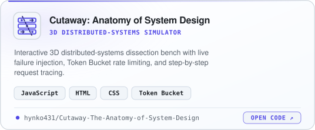
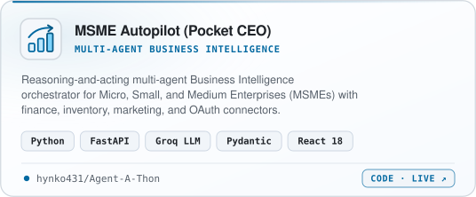
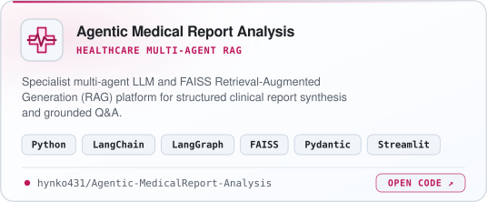

  <a href="https://hynko431.github.io/hynko431/"><picture><source media="(prefers-color-scheme: dark)" srcset="https://hynko431.github.io/hynko431/assets/banner-3d-dark.svg" /><source media="(prefers-color-scheme: light)" srcset="https://hynko431.github.io/hynko431/assets/banner-3d-light.svg" /></picture></a>

   

  <a href="https://siva-venkata-bhanu-prakash-portofol.vercel.app/"><picture><source media="(prefers-color-scheme: dark)" srcset="./assets/icons/contact-portfolio-dark.svg" /><source media="(prefers-color-scheme: light)" srcset="./assets/icons/contact-portfolio-light.svg" /></picture></a>
  <a href="https://www.linkedin.com/in/siva-venkata-bhanu-prakash/"><picture><source media="(prefers-color-scheme: dark)" srcset="./assets/icons/contact-linkedin-dark.svg" /><source media="(prefers-color-scheme: light)" srcset="./assets/icons/contact-linkedin-light.svg" /></picture></a>
  <a href="mailto:irakamsivabhanuprakash@gmail.com"><picture><source media="(prefers-color-scheme: dark)" srcset="./assets/icons/contact-email-dark.svg" /><source media="(prefers-color-scheme: light)" srcset="./assets/icons/contact-email-light.svg" /></picture></a>
  <a href="https://x.com/Sivabhanu7198"><picture><source media="(prefers-color-scheme: dark)" srcset="./assets/icons/contact-x-dark.svg" /><source media="(prefers-color-scheme: light)" srcset="./assets/icons/contact-x-light.svg" /></picture></a>

Full-Stack Software Engineer (Jr. SDE) shipping end-to-end web platforms across React, TypeScript, Node.js/Express, Python/FastAPI, and PostgreSQL, alongside distributed task queues, search/OCR microservices, and TypeScript/Rust security tooling.

---

## Experience

### Saral Vidhya *(Hyderabad · On-site)*

**Junior Software Development Engineer (Jr. SDE)** · Full-time *(Nov 2026 – Present)*

- Built end-to-end sectional reading REST APIs (Node.js/Express, TypeScript, Firestore, GCS on Cloud Run) and modular React 18/TypeScript workspaces, moving external APIs behind hardened backend proxies with Gitleaks and TruffleHog CI scans.
- Architected multi-tenant PostgreSQL 18 schemas across 15 Alembic migrations with learner Row-Level Security (RLS), SQLAlchemy versioning, and pgvector indexing; verified releases via 152 passing pytest tests, 5 SQL workflow suites, Ruff, and frontend builds.
- Engineered Celery + Redis asynchronous task queues with retries, dead-letter queues (DLQ), Prometheus alerts, and single-copy MinIO object storage to decouple heavy document processing from user-facing FastAPI endpoints.

**AI ML Intern** · Internship *(May 2026 – Nov 2026)*

- Delivered a sliding-window OCR pipeline processing 1,000-page PDFs within 512 MB RAM (90%+ extraction accuracy) and an LLM-as-a-Judge + Human-in-the-Loop (HITL) grading workflow backed by FastAPI and PostgreSQL/Supabase.
- Implemented hybrid BM25/vector Retrieval-Augmented Generation (RAG) with Cache-Augmented Generation (CAG), JWT/RBAC, Google OAuth2 security, and Docker Compose deployment.

### ASAR IT Technologies Private Limited *(Bengaluru · On-site)*

**AI Engineer Intern** · Internship *(Jan 2026 – May 2026)*

- Built the Python/FastAPI prescription OCR and document-intelligence microservice (MedVault) integrated via Docker Compose with the Node.js/Express + PostgreSQL API gateway and React Native app, adding circuit breakers, rate limiting, and 3-tier OCR/LLM fallbacks.
- Engineered Elasticsearch hybrid search, autocomplete, relevance reranking, and zero-downtime index migrations (v1–v8), paired with 50-connection Redis pooling, ORJSON, and Level-6 GZip compression cutting large JSON payloads by up to 80%.
- Implemented Pydantic v2 schema validation and medical-aware OCR normalization (~300ms medicine parsing latency) alongside a LangChain + FAISS RAG medication assistant with automated API and search tests.

### SmartBridge Educational Services × APSCHE *(Remote)*

**AI & ML Intern** · Internship *(Jun 2025 – Jul 2025)*

- Completed applied Python and scikit-learn preprocessing, feature engineering, predictive modeling, and evaluation workflows (Andhra Pradesh State Council of Higher Education; Cert ID EXT-APSCHE_AIML-50038).

---

## Education

**B.Tech in Computer Science & Engineering** — Jawaharlal Nehru Technological University Anantapur (JNTUA) College of Engineering, Pulivendula — CGPA: 7.8 / 10 *(2022 – 2026)*

---

## Featured Projects

  <a href="https://github.com/hynko431/Coldpin-npx-Safe-Finder"><picture><source media="(prefers-color-scheme: dark)" srcset="./assets/cards/coldpin-dark.svg" /><source media="(prefers-color-scheme: light)" srcset="./assets/cards/coldpin-light.svg" /></picture></a> &nbsp; <a href="https://github.com/hynko431/OmniConnect-Sentinel"><picture><source media="(prefers-color-scheme: dark)" srcset="./assets/cards/sentinel-dark.svg" /><source media="(prefers-color-scheme: light)" srcset="./assets/cards/sentinel-light.svg" /></picture></a>
   
  <a href="https://github.com/hynko431/Cutaway-The-Anatomy-of-System-Design"><picture><source media="(prefers-color-scheme: dark)" srcset="./assets/cards/cutaway-dark.svg" /><source media="(prefers-color-scheme: light)" srcset="./assets/cards/cutaway-light.svg" /></picture></a> &nbsp; <a href="https://github.com/hynko431/Helix--AI-Discovery-Platform"><picture><source media="(prefers-color-scheme: dark)" srcset="./assets/cards/helix-dark.svg" /><source media="(prefers-color-scheme: light)" srcset="./assets/cards/helix-light.svg" /></picture></a>
   
  <a href="https://github.com/hynko431/Agent-A-Thon"><picture><source media="(prefers-color-scheme: dark)" srcset="./assets/cards/autopilot-dark.svg" /><source media="(prefers-color-scheme: light)" srcset="./assets/cards/autopilot-light.svg" /></picture></a> &nbsp; <a href="https://github.com/hynko431/Agentic-MedicalReport-Analysis"><picture><source media="(prefers-color-scheme: dark)" srcset="./assets/cards/medical-dark.svg" /><source media="(prefers-color-scheme: light)" srcset="./assets/cards/medical-light.svg" /></picture></a>

*Docs & Live:* [Coldpin Docs](https://coldpin-docs.pages.dev/) · [MSME Autopilot Live](https://agent-a-thon.vercel.app/) — *Also built:* [Conversational AI Avatar](https://github.com/hynko431/Conversational-AI-Avatar) *(Anam.ai · Zep Cloud · FastAPI · Streamlit)* · [Agentic Data Scientist](https://github.com/hynko431/Agentic-Data-Scientist) *(Automated drift detection & retraining)* · [HematoVision](https://github.com/hynko431/HematoVision-Advanced-Blood-Cell-Classification-Using-Transfer-Learning) *(MobileNetV2 transfer learning)* — [View all repositories →](https://github.com/hynko431?tab=repositories) · [Filter Projects in 3D Explorer →](https://hynko431.github.io/hynko431/#projects)

---

## Tech Stack Architecture

  <a href="https://hynko431.github.io/hynko431/#stack"><picture><source media="(prefers-color-scheme: dark)" srcset="./assets/stack-3d-dark.svg" /><source media="(prefers-color-scheme: light)" srcset="./assets/stack-3d-light.svg" /></picture></a>

<a href="https://hynko431.github.io/hynko431/#stack">Explore Interactive 3D Tech Stack &amp; Filter Projects →</a>

---

## 3D Contribution Skyline

  <a href="https://hynko431.github.io/hynko431/#skyline"><picture><source media="(prefers-color-scheme: dark)" srcset="https://hynko431.github.io/hynko431/assets/contrib-3d-dark.svg" /><source media="(prefers-color-scheme: light)" srcset="https://hynko431.github.io/hynko431/assets/contrib-3d-light.svg" /></picture></a>

<a href="https://hynko431.github.io/hynko431/">Open Interactive 3D Profile Explorer →</a>

