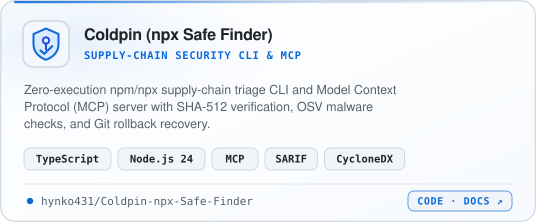
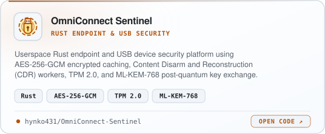
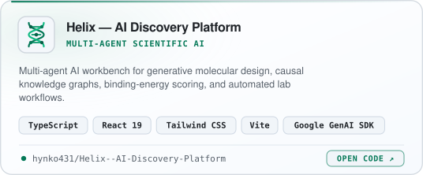

  <a href="https://hynko431.github.io/hynko431/"><picture><source media="(prefers-color-scheme: dark)" srcset="https://hynko431.github.io/hynko431/assets/banner-3d-dark.svg" /><source media="(prefers-color-scheme: light)" srcset="https://hynko431.github.io/hynko431/assets/banner-3d-light.svg" /></picture></a>

   

  <a href="https://siva-venkata-bhanu-prakash-portofol.vercel.app/"><picture><source media="(prefers-color-scheme: dark)" srcset="./assets/icons/contact-portfolio-dark.svg" /><source media="(prefers-color-scheme: light)" srcset="./assets/icons/contact-portfolio-light.svg" /></picture></a>
  <a href="https://www.linkedin.com/in/siva-venkata-bhanu-prakash/"><picture><source media="(prefers-color-scheme: dark)" srcset="./assets/icons/contact-linkedin-dark.svg" /><source media="(prefers-color-scheme: light)" srcset="./assets/icons/contact-linkedin-light.svg" /></picture></a>
  <a href="mailto:irakamsivabhanuprakash@gmail.com"><picture><source media="(prefers-color-scheme: dark)" srcset="./assets/icons/contact-email-dark.svg" /><source media="(prefers-color-scheme: light)" srcset="./assets/icons/contact-email-light.svg" /></picture></a>
  <a href="https://x.com/Sivabhanu7198"><picture><source media="(prefers-color-scheme: dark)" srcset="./assets/icons/contact-x-dark.svg" /><source media="(prefers-color-scheme: light)" srcset="./assets/icons/contact-x-light.svg" /></picture></a>

Backend and Applied AI engineer building distributed Python/FastAPI services, schema-validated LLM and retrieval pipelines, and supply-chain/endpoint security tools across Python, TypeScript, and Rust.

---

## Experience

### Saral Vidhya *(Hyderabad · On-site)*

**Jr. SDE - Backend** · Full-time *(Nov 2026 – Present)*

- Architecting backend APIs, relational data models, and asynchronous task queues using Python, FastAPI, PostgreSQL, Celery, and Redis.
- Building low-latency search, authentication, and AI service integrations for production academic evaluation workflows.

**AI ML Intern** · Internship *(May 2026 – Nov 2026)*

- Built an LLM-as-a-Judge rubric grading system with a Human-in-the-Loop (HITL) review workflow backed by FastAPI and PostgreSQL/Supabase.
- Implemented large-document Optical Character Recognition (OCR) ingestion, Retrieval-Augmented Generation (RAG) with Cache-Augmented Generation (CAG), JWT/RBAC/Google OAuth2 security, and Docker deployment.

### ASAR IT Technologies *(Bengaluru · On-site)*

**Artificial Intelligence Engineer** · Internship *(Jan 2026 – Apr 2026)*

- Built schema-validated deterministic LLM extraction pipelines achieving 99% JSON validity at 300ms average latency.
- Reduced OCR noise by 90% and improved extraction F1 score by +18%, backed by LangChain, FAISS, FastAPI, automated tests, and evaluation dashboards.

### SmartBridge Educational Services × APSCHE *(Remote)*

**AI & ML Intern** · Internship *(Jun 2025 – Jul 2025)*

- Completed applied Python and scikit-learn preprocessing, feature engineering, predictive modeling, and evaluation workflows (Andhra Pradesh State Council of Higher Education; Cert ID EXT-APSCHE_AIML-50038).

---

## Education

**B.Tech in Computer Science & Engineering** — Jawaharlal Nehru Technological University Anantapur (JNTUA) College of Engineering, Pulivendula *(2022 – 2026)*

---

## Featured Projects

  <a href="https://github.com/hynko431/Coldpin-npx-Safe-Finder"><picture><source media="(prefers-color-scheme: dark)" srcset="./assets/cards/coldpin-dark.svg" /><source media="(prefers-color-scheme: light)" srcset="./assets/cards/coldpin-light.svg" /></picture></a> &nbsp; <a href="https://github.com/hynko431/OmniConnect-Sentinel"><picture><source media="(prefers-color-scheme: dark)" srcset="./assets/cards/sentinel-dark.svg" /><source media="(prefers-color-scheme: light)" srcset="./assets/cards/sentinel-light.svg" /></picture></a>
   
  <a href="https://github.com/hynko431/Cutaway-The-Anatomy-of-System-Design"><picture><source media="(prefers-color-scheme: dark)" srcset="./assets/cards/cutaway-dark.svg" /><source media="(prefers-color-scheme: light)" srcset="./assets/cards/cutaway-light.svg" /></picture></a> &nbsp; <a href="https://github.com/hynko431/Helix--AI-Discovery-Platform"><picture><source media="(prefers-color-scheme: dark)" srcset="./assets/cards/helix-dark.svg" /><source media="(prefers-color-scheme: light)" srcset="./assets/cards/helix-light.svg" /></picture></a>
   
  <a href="https://github.com/hynko431/Agent-A-Thon"><picture><source media="(prefers-color-scheme: dark)" srcset="./assets/cards/autopilot-dark.svg" /><source media="(prefers-color-scheme: light)" srcset="./assets/cards/autopilot-light.svg" /></picture></a> &nbsp; <a href="https://github.com/hynko431/Agentic-MedicalReport-Analysis"><picture><source media="(prefers-color-scheme: dark)" srcset="./assets/cards/medical-dark.svg" /><source media="(prefers-color-scheme: light)" srcset="./assets/cards/medical-light.svg" /></picture></a>

*Docs & Live:* [Coldpin Docs](https://coldpin-docs.pages.dev/) · [MSME Autopilot Live](https://agent-a-thon.vercel.app/) — *Also built:* [Conversational AI Avatar](https://github.com/hynko431/Conversational-AI-Avatar) *(Anam.ai · Zep Cloud · FastAPI · Streamlit)* · [Agentic Data Scientist](https://github.com/hynko431/Agentic-Data-Scientist) *(Automated drift detection & retraining)* · [HematoVision](https://github.com/hynko431/HematoVision-Advanced-Blood-Cell-Classification-Using-Transfer-Learning) *(MobileNetV2 transfer learning)* — [View all repositories →](https://github.com/hynko431?tab=repositories) · [Filter Projects in 3D Explorer →](https://hynko431.github.io/hynko431/#projects)

---

## Tech Stack Architecture

  <a href="https://hynko431.github.io/hynko431/#stack"><picture><source media="(prefers-color-scheme: dark)" srcset="./assets/stack-3d-dark.svg" /><source media="(prefers-color-scheme: light)" srcset="./assets/stack-3d-light.svg" /></picture></a>

<a href="https://hynko431.github.io/hynko431/#stack">Explore Interactive 3D Tech Stack &amp; Filter Projects →</a>

---

## 3D Contribution Skyline

  <a href="https://hynko431.github.io/hynko431/#skyline"><picture><source media="(prefers-color-scheme: dark)" srcset="https://hynko431.github.io/hynko431/assets/contrib-3d-dark.svg" /><source media="(prefers-color-scheme: light)" srcset="https://hynko431.github.io/hynko431/assets/contrib-3d-light.svg" /></picture></a>

<a href="https://hynko431.github.io/hynko431/">Open Interactive 3D Profile Explorer →</a>

