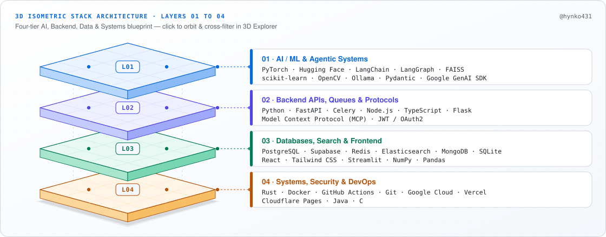
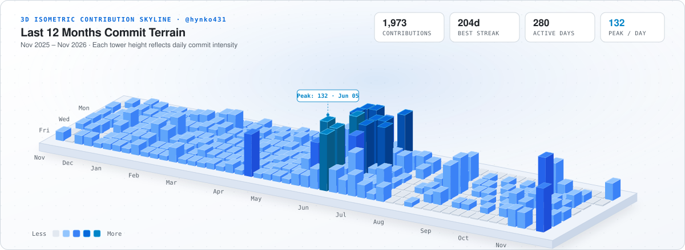

  <a href="https://hynko431.github.io/hynko431/"><picture><source media="(prefers-color-scheme: dark)" srcset="./assets/banner-3d-dark.svg" /><source media="(prefers-color-scheme: light)" srcset="./assets/banner-3d-light.svg" /></picture></a>

   

  <a href="https://siva-venkata-bhanu-prakash-portofol.vercel.app/"><picture><source media="(prefers-color-scheme: dark)" srcset="./assets/icons/contact-portfolio-dark.svg" /><source media="(prefers-color-scheme: light)" srcset="./assets/icons/contact-portfolio-light.svg" /></picture></a>
  <a href="https://www.linkedin.com/in/siva-venkata-bhanu-prakash/"><picture><source media="(prefers-color-scheme: dark)" srcset="./assets/icons/contact-linkedin-dark.svg" /><source media="(prefers-color-scheme: light)" srcset="./assets/icons/contact-linkedin-light.svg" /></picture></a>
  <a href="mailto:irakamsivabhanuprakash@gmail.com"><picture><source media="(prefers-color-scheme: dark)" srcset="./assets/icons/contact-email-dark.svg" /><source media="(prefers-color-scheme: light)" srcset="./assets/icons/contact-email-light.svg" /></picture></a>
  <a href="https://x.com/Sivabhanu7198"><picture><source media="(prefers-color-scheme: dark)" srcset="./assets/icons/contact-x-dark.svg" /><source media="(prefers-color-scheme: light)" srcset="./assets/icons/contact-x-light.svg" /></picture></a>

Backend and Applied AI engineer building distributed Python/FastAPI services, schema-validated LLM and retrieval pipelines, and supply-chain/endpoint security tools across Python, TypeScript, and Rust.

---

## Experience

### Saral Vidhya *(Hyderabad · On-site)*

**Jr. SDE - Backend** · Full-time *(Nov 2026 – Present)*

- Architecting backend APIs, relational data models, and asynchronous task queues using Python, FastAPI, PostgreSQL, Celery, and Redis.
- Building low-latency search, authentication, and AI service integrations for production academic evaluation workflows.

**AI ML Intern** · Internship *(May 2026 – Nov 2026)*

- Built an LLM-as-a-Judge rubric grading system with a Human-in-the-Loop (HITL) review workflow backed by FastAPI and PostgreSQL/Supabase.
- Implemented large-document Optical Character Recognition (OCR) ingestion, Retrieval-Augmented Generation (RAG) with Cache-Augmented Generation (CAG), JWT/RBAC/Google OAuth2 security, and Docker deployment.

### ASAR IT Technologies *(Bengaluru · On-site)*

**Artificial Intelligence Engineer** · Internship *(Jan 2026 – Apr 2026)*

- Built schema-validated deterministic LLM extraction pipelines achieving 99% JSON validity at 300ms average latency.
- Reduced OCR noise by 90% and improved extraction F1 score by +18%, backed by LangChain, FAISS, FastAPI, automated tests, and evaluation dashboards.

### SmartBridge Educational Services × APSCHE *(Remote)*

**AI & ML Intern** · Internship *(Jun 2025 – Jul 2025)*

- Completed applied Python and scikit-learn preprocessing, feature engineering, predictive modeling, and evaluation workflows (Andhra Pradesh State Council of Higher Education; Cert ID EXT-APSCHE_AIML-50038).

---

## Education

**B.Tech in Computer Science & Engineering** — Jawaharlal Nehru Technological University Anantapur (JNTUA) College of Engineering, Pulivendula *(2022 – 2026)*

---

## Featured Projects

<table>
  <tbody>
    <tr>
      <td align="center" width="64"><picture><source media="(prefers-color-scheme: dark)" srcset="./assets/icons/coldpin-dark.svg" /><source media="(prefers-color-scheme: light)" srcset="./assets/icons/coldpin-light.svg" /></picture></td>
      <td>
        <strong>Coldpin (npx Safe Finder)</strong> — <em>Supply-Chain Security CLI &amp; MCP</em> 
        Zero-execution npm/npx supply-chain triage CLI and Model Context Protocol (MCP) server with SHA-512 verification, OSV malware checks, and Git rollback recovery. 
        <code>TypeScript</code> <code>Node.js 24</code> <code>MCP</code> <code>SARIF</code> <code>CycloneDX</code> 
        <a href="https://github.com/hynko431/Coldpin-npx-Safe-Finder">Code</a> · <a href="https://coldpin-docs.pages.dev/">Docs</a>
      </td>
    </tr>
    <tr>
      <td align="center" width="64"><picture><source media="(prefers-color-scheme: dark)" srcset="./assets/icons/sentinel-dark.svg" /><source media="(prefers-color-scheme: light)" srcset="./assets/icons/sentinel-light.svg" /></picture></td>
      <td>
        <strong>OmniConnect Sentinel</strong> — <em>Rust Endpoint &amp; USB Security</em> 
        Userspace Rust endpoint and USB device security platform using AES-256-GCM encrypted caching, Content Disarm and Reconstruction (CDR) workers, TPM 2.0, and ML-KEM-768 post-quantum key exchange. 
        <code>Rust</code> <code>AES-256-GCM</code> <code>TPM 2.0</code> <code>ML-KEM-768</code> 
        <a href="https://github.com/hynko431/OmniConnect-Sentinel">Code</a>
      </td>
    </tr>
    <tr>
      <td align="center" width="64"><picture><source media="(prefers-color-scheme: dark)" srcset="./assets/icons/cutaway-dark.svg" /><source media="(prefers-color-scheme: light)" srcset="./assets/icons/cutaway-light.svg" /></picture></td>
      <td>
        <strong>Cutaway: Anatomy of System Design</strong> — <em>3D Distributed-Systems Simulator</em> 
        Interactive 3D distributed-systems dissection bench with live failure injection, Token Bucket rate limiting, and step-by-step request tracing. 
        <code>JavaScript</code> <code>HTML</code> <code>CSS</code> <code>Token Bucket</code> 
        <a href="https://github.com/hynko431/Cutaway-The-Anatomy-of-System-Design">Code</a>
      </td>
    </tr>
    <tr>
      <td align="center" width="64"><picture><source media="(prefers-color-scheme: dark)" srcset="./assets/icons/helix-dark.svg" /><source media="(prefers-color-scheme: light)" srcset="./assets/icons/helix-light.svg" /></picture></td>
      <td>
        <strong>Helix — AI Discovery Platform</strong> — <em>Multi-Agent Scientific AI</em> 
        Multi-agent AI workbench for generative molecular design, causal knowledge graphs, binding-energy scoring, and automated lab workflows. 
        <code>TypeScript</code> <code>React 19</code> <code>Tailwind CSS</code> <code>Vite</code> <code>Google GenAI SDK</code> 
        <a href="https://github.com/hynko431/Helix--AI-Discovery-Platform">Code</a>
      </td>
    </tr>
    <tr>
      <td align="center" width="64"><picture><source media="(prefers-color-scheme: dark)" srcset="./assets/icons/autopilot-dark.svg" /><source media="(prefers-color-scheme: light)" srcset="./assets/icons/autopilot-light.svg" /></picture></td>
      <td>
        <strong>MSME Autopilot (Pocket CEO)</strong> — <em>Multi-Agent Business Intelligence</em> 
        Reasoning-and-acting multi-agent Business Intelligence orchestrator for Micro, Small, and Medium Enterprises (MSMEs) with finance, inventory, marketing, and OAuth connectors. 
        <code>Python</code> <code>FastAPI</code> <code>Groq LLM</code> <code>Pydantic</code> <code>React 18</code> 
        <a href="https://github.com/hynko431/Agent-A-Thon">Code</a> · <a href="https://agent-a-thon.vercel.app/">Live</a>
      </td>
    </tr>
    <tr>
      <td align="center" width="64"><picture><source media="(prefers-color-scheme: dark)" srcset="./assets/icons/medical-dark.svg" /><source media="(prefers-color-scheme: light)" srcset="./assets/icons/medical-light.svg" /></picture></td>
      <td>
        <strong>Agentic Medical Report Analysis</strong> — <em>Healthcare Multi-Agent RAG</em> 
        Specialist multi-agent LLM and FAISS Retrieval-Augmented Generation (RAG) platform for structured clinical report synthesis and grounded Q&amp;A. 
        <code>Python</code> <code>LangChain</code> <code>LangGraph</code> <code>FAISS</code> <code>Pydantic</code> <code>Streamlit</code> 
        <a href="https://github.com/hynko431/Agentic-MedicalReport-Analysis">Code</a>
      </td>
    </tr>
  </tbody>
</table>

*Also built:* [Conversational AI Avatar](https://github.com/hynko431/Conversational-AI-Avatar) *(Anam.ai · Zep Cloud · FastAPI · Streamlit)* · [Agentic Data Scientist](https://github.com/hynko431/Agentic-Data-Scientist) *(Automated drift detection & retraining)* · [HematoVision](https://github.com/hynko431/HematoVision-Advanced-Blood-Cell-Classification-Using-Transfer-Learning) *(MobileNetV2 transfer learning)* — [View all repositories →](https://github.com/hynko431?tab=repositories) · [Filter Projects in 3D Explorer →](https://hynko431.github.io/hynko431/#projects)

---

## Tech Stack Architecture

  <a href="https://hynko431.github.io/hynko431/#stack"><picture><source media="(prefers-color-scheme: dark)" srcset="./assets/stack-3d-dark.svg" /><source media="(prefers-color-scheme: light)" srcset="./assets/stack-3d-light.svg" /></picture></a>

| Tier | Category | Technologies |
| :--- | :--- | :--- |
| `01` | **AI / ML & Agentic Systems** | `PyTorch`, `Hugging Face`, `LangChain`, `LangGraph`, `FAISS`, `scikit-learn`, `OpenCV`, `Ollama`, `Pydantic`, `Google GenAI SDK` |
| `02` | **Backend APIs, Queues & Protocols** | `Python`, `FastAPI`, `Celery`, `Node.js`, `TypeScript`, `Flask`, `Model Context Protocol (MCP)`, `JWT / OAuth2` |
| `03` | **Databases, Search & Frontend** | `PostgreSQL`, `Supabase`, `Redis`, `Elasticsearch`, `MongoDB`, `SQLite`, `React`, `Tailwind CSS`, `Streamlit`, `NumPy`, `Pandas` |
| `04` | **Systems, Security & DevOps** | `Rust`, `Docker`, `GitHub Actions`, `Git`, `Google Cloud`, `Vercel`, `Cloudflare Pages`, `Java`, `C` |

---

## 3D Contribution Skyline

  <a href="https://hynko431.github.io/hynko431/#skyline"><picture><source media="(prefers-color-scheme: dark)" srcset="./assets/contrib-3d-dark.svg" /><source media="(prefers-color-scheme: light)" srcset="./assets/contrib-3d-light.svg" /></picture></a>

<a href="https://hynko431.github.io/hynko431/">Open Interactive 3D Profile Explorer →</a>

